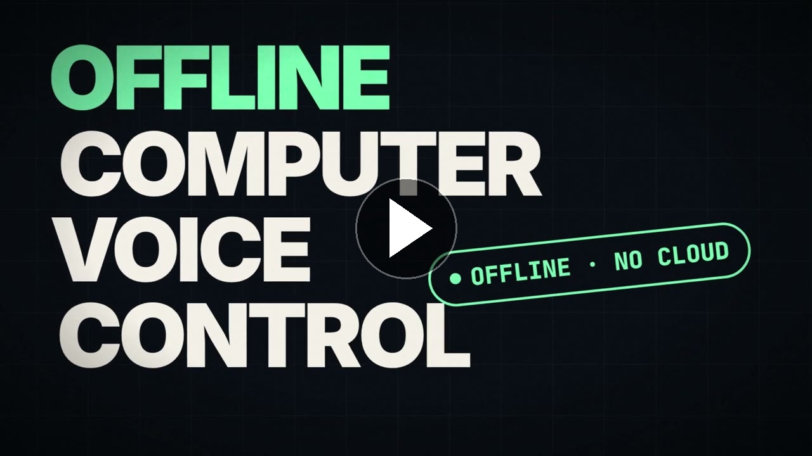
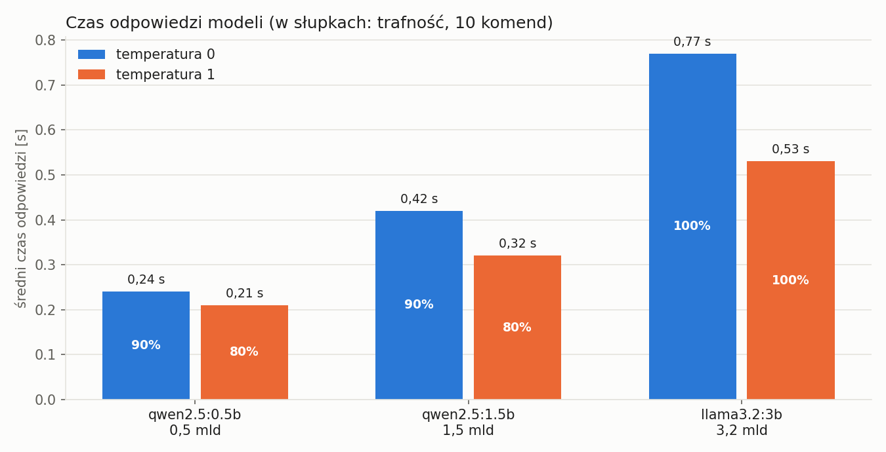

# Offline Computer Voice Control

Lokalny asystent głosowy do sterowania komputerem z systemem Windows, działający offline. Projekt wykorzystuje lokalne rozpoznawanie mowy (Whisper) oraz mały model językowy (LLM) uruchamiany lokalnie przez Ollamę do zamiany poleceń głosowych na konkretne akcje w systemie.

## Demo

## Funkcje
- **Przeglądarka:** Wyszukiwanie haseł w Google oraz odtwarzanie treści na YouTube.
- **Notatki:** Szybkie otwieranie Notatnika i dyktowanie notatek (z obsługą polskich znaków).
- **Multimedia:** Uruchamianie Spotify i wznawianie odtwarzania.
- **Kalkulator:** Rozpoznawanie działań matematycznych z mowy i bezpieczne obliczanie ich wyników.

## Wymagania wstępne
1. **Python 3.10+**
2. **Ollama** zainstalowana lokalnie na komputerze ([ollama.com](https://ollama.com)) wraz z pobranym modelem:
   ollama pull qwen2.5:0.5b
   ollama pull qwen2.5:1.5b
   ollama pull llama3.2:3b

## Instalacja i uruchomienie

1. Sklonuj repozytorium:
   git clone https://github.com/malkwasnie/offline-computer-voice-control.git
   cd offline-computer-voice-control

2. Utwórz i aktywuj środowisko wirtualne:
   python -m venv venv
   .\venv\Scripts\activate

3. Zainstaluj wymagane biblioteki:
   pip install -r requirements.txt

4. Uruchom aplikację:
   - Kliknij dwukrotnie plik **`start.bat`** w folderze projektu, **lub**
   - Wpisz w terminalu: `python main.py`

## Przykładowe komendy głosowe
- *"Odpal na YouTube muzykę zespołu Queen"*
- *"Wyszukaj w Google jaka jest pogoda w Gdańsku"*
- *"Zanotuj, że jutro oddajemy projekt"*
- *"Otwórz Spotify i włącz ostatnią piosenkę"*
- *"Oblicz 50 podzielone na 25"*

## Wyniki benchmarku

Pomiar zespołu skryptem `benchmark.py`: 10 komend (po 2 na akcję), liczy się wybór właściwej akcji, czas to średni czas odpowiedzi modelu. Jedno uruchomienie dla każdej temperatury.

| Model | Parametry | Temp. 0: trafność | czas | Temp. 1: trafność | czas |
|---|---:|---:|---:|---:|---:|
| qwen2.5:0.5b (używany w aplikacji) | 0,5 mld | 90% | 0,24 s | 80% | 0,21 s |
| qwen2.5:1.5b | 1,5 mld | 90% | 0,42 s | 80% | 0,32 s |
| llama3.2:3b | 3,2 mld | 100% | 0,77 s | 100% | 0,53 s |

Przy 10 komendach jedna pomyłka to 10 punktów procentowych, więc różnice 80–90% są w granicach jednego polecenia.

## Prezentacja

- [docs/prezentacja.pdf](docs/prezentacja.pdf) – 10 slajdów
- [docs/prezentacja.pptx](docs/prezentacja.pptx) – te same slajdy w PowerPoincie

## Użycie AI w procesie tworzenia projektu

Koncepcja projektu, dobór funkcjonalności, zaprojektowanie logiki działania oraz eksperymenty z lokalnymi modelami językowymi zostały opracowane samodzielnie przez zespół. 

W trakcie prac wykorzystaliśmy **Gemini** jako wsparcie techniczne w celu:
- **konsultacji architektonicznych** (dobór odpowiednich bibliotek Pythona do nagrywania dźwięku, transkrypcji offline oraz integracji z Ollamą),
- **debugowania i rozwiązywania problemów technicznych** (m.in. obsługa niezgodności wersji bibliotek audio, bezpieczne parsowanie odpowiedzi JSON oraz oddelegowanie obliczeń matematycznych z małego modelu LLM do kodu Pythona),
- **optymalizacji prompt engineeringu** (*few-shot prompting*) pod kątem małych modeli językowych (0.5B–1.5B parametrów),
- **przyspieszenia nauki nowych narzędzi** i dobrych praktyk pracy z repozytorium Git.
- **dokonanie testów** i napisanie kodu odpowiedzialnego za porównanie trzech modeli
